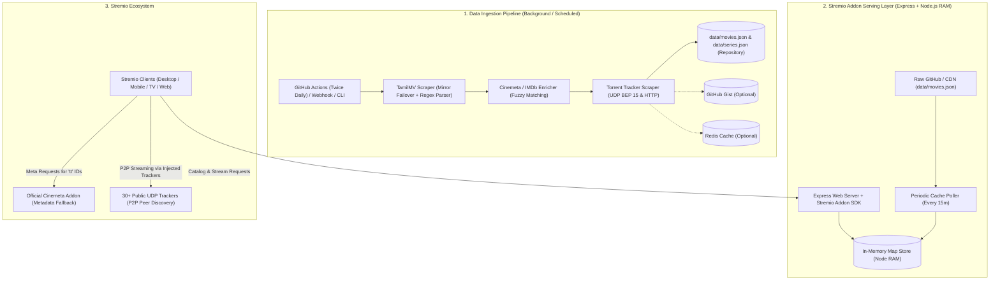
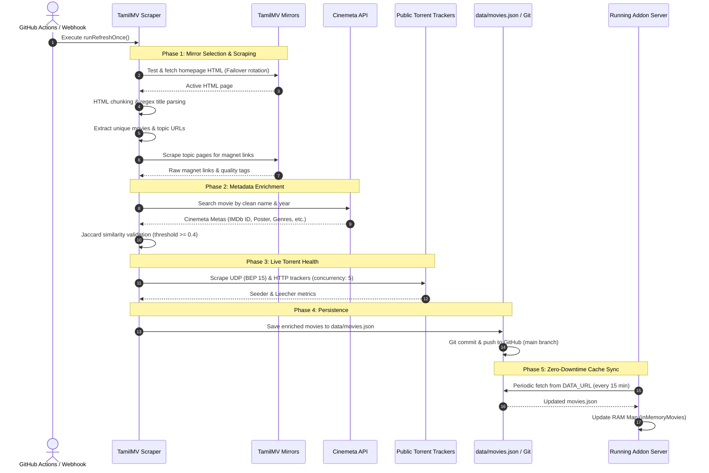

# Architecture & Data Pipeline Guide: InMax (TamilMV Stremio Addon)

This document provides a comprehensive technical overview of the **InMax (TamilMV Stremio Addon)** architecture, explaining its decoupled design, how movie data is scraped, enriched, and updated, and how streaming requests are handled with sub-millisecond latency.

---

## 1. System Architecture Overview

The addon is architected as a **decoupled, static-first, zero-database-required** streaming service. 

Instead of scraping TamilMV forums synchronously during user requests (which would cause severe latency, Cloudflare blocks, and timeouts), the system decouples **data ingestion (scraping/enrichment)** from **data serving (Stremio SDK API)**.



---

## 2. Core Architectural Components

### 2.1 The Serving Layer (`src/index.ts`, `src/stremio/addon.ts`)
- **Technology**: Built using Node.js, TypeScript, Express 5, and `stremio-addon-sdk`.
- **In-Memory Catalog**: Movies and magnets are stored directly in a JavaScript `Map<string, EnrichedMovie>` in RAM (`src/services/cache.ts`).
- **Sub-Millisecond Response Times**: Read queries (`/catalog`, `/stream`, `/meta`) require 0 database roundtrips and no external HTTP requests during user interaction.
- **Keep-Alive Worker**: Pings itself (`/manifest.json`) every 10 minutes when deployed on free-tier container platforms (like Render.com) to prevent instance idling.
- **Stremio Protocol Handlers**:
  - `catalog`:
    - `tamilmv-now` (`type: 'movie'`): Serves movies with pagination (`skip`, `limit`) and language filters (`Tamil`, `Malayalam`, `Telugu`, `Kannada`, `Hindi`, `Multi-Lang`).
    - `tamilmv-series` (`type: 'series'`, name: `Big Boss`): Serves daily Bigg Boss episodes with genre filters (`Tamil`, `Telugu`).
  - `stream`: Resolves streams for movie and series episode IDs (`<seriesId>:<season>:<episode>`). Parses `infoHash`, injects 30+ high-performance public UDP trackers, and formats titles with language, resolution, codec (HEVC/AVC), file size, and live seeders/leechers.
  - `meta`: Serves full series episode trees (`videos` array) for Bigg Boss series (`tamilmv-series-bigg-boss-tamil`, `tamilmv-series-bigg-boss-telugu`, `tt7084920`, `tt7805494`) and custom movie `tamilmv-*` IDs. Standard `tt*` movie IDs defer metadata resolution to Stremio's native Cinemeta addon.

### 2.2 The Ingestion Pipeline (`src/scraper/tamilmv.ts`, `src/services/imdb.ts`, `src/services/torrent.ts`)
- **Trigger**: Runs via automated scheduled GitHub Actions (`.github/workflows/scrape.yml`), manual workflow dispatch, external authenticated webhook (`/scrape?secret=...`), or manual CLI (`npm run scrape:once`).
- **Independent Execution**: Runs out-of-band as a standalone Node.js process using `tsx src/scheduler/job.ts`.

---

## 3. How Movies Are Updated (End-to-End Lifecycle)

The update lifecycle moves through **5 sequential phases**:



### Detailed Breakdown of Each Phase

#### Phase 1: Scraping TamilMV (`src/scraper/tamilmv.ts`)
1. **Mirror Failover Engine**:
   - Rotates through known mirrors (`config.tamilmvBaseUrl`, `1tamilmv.fi`, `1tamilmv.observer`, `1tamilmv.meme`) with browser-impersonating HTTP headers.
   - If an ISP or Cloudflare blocks one domain, the scraper automatically falls back to an active mirror and locks it as the `workingBaseUrl`.
2. **HTML Splitting & Chunking**:
   - The homepage HTML is split by layout tags (`<br>`, `<p>`, `<div>`, `<tr>`, `<li>`).
   - Prevents multiple releases located in adjacent DOM nodes from merging into a single string.
3. **Filtering & Deduplication**:
   - Ignores TV series / episode formats (`S01`, `EP (...)`) and spam/Telegram links.
   - Extracts release years and clean movie titles (`titleGuess`).
   - Detects language tags (`Tamil`, `Malayalam`, `Telugu`, `Kannada`, `Hindi`, `Multi-Lang`).
   - Generates a deterministic MD5 hash (`makeId(rawTitle)`). If multiple forum topics exist for the same title, they are aggregated under the same movie ID.
4. **Deep Topic Page Scraping**:
   - For each unique movie, navigates to its forum topic page(s).
   - Scrapes all magnet URLs (`magnet:?xt=urn:btih:...`).
   - Parses display names (`dn=`) and text markers for stream quality (`2160p`, `1080p`, `720p`, `480p`), codecs (`HEVC`/`x265`, `AVC`/`x264`), audio features (`Multi-Audio`, `Dual-Audio`), and file sizes (e.g., `1.4GB`).

#### Phase 2: Metadata Enrichment (`src/services/imdb.ts`)
1. **Cinemeta Query**:
   - Calls the public Cinemeta API (`v3-cinemeta.strem.io/catalog/movie/top/search=<title>.json`).
2. **Fuzzy Token Matching**:
   - Computes Jaccard token similarity between the scraped title and the Cinemeta entry.
   - Cross-checks release year with $\pm 1$ year tolerance.
3. **Enrichment Decision**:
   - If similarity $\ge 0.4$, assigns the official IMDb ID (`tt*`), poster image, background thumbnail, official genres, description, and IMDb rating.
   - If similarity $< 0.4$, retains the internal ID (`tamilmv-<hash>`) with scraped raw metadata to avoid displaying incorrect posters or mismatched titles.

#### Phase 3: Real-Time Torrent Health Scrape (`src/services/torrent.ts`)
1. **InfoHash Decoding**:
   - Decodes 40-character hexadecimal info hashes as well as 32-character base32 hashes into 20-byte buffers.
2. **BEP 15 UDP Tracker Protocol**:
   - Directly negotiates UDP connection handshakes (`Protocol ID: 0x41727101980`) and transmits scrape action requests to high-speed public trackers.
   - Supports HTTP scrape fallback (`/scrape?info_hash=...`).
3. **Batch Concurrency**:
   - Queries trackers across batches of 5 streams in parallel with timeouts, writing live seeders and leechers onto each quality stream.

#### Phase 4: Persistence & Storage Synchronization (`src/services/cache.ts`)
1. **Deduplication & In-Memory Update**:
   - Merges identical magnet links and combines language sets.
2. **Local Repository Commit**:
   - Writes the new dataset to `data/movies.json`.
3. **GitHub Automation & Render Build Prevention**:
   - The GitHub Actions workflow (`.github/workflows/scrape.yml`) runs `git add data/movies.json`, commits with `[skip ci] [skip render]`, and pushes the file directly to the `main` branch.
   - Combined with Render's `buildFilter` configured in `render.yaml`, Render automatically ignores catalog updates and does not trigger wasteful redeployments or consume build minutes.
4. **Optional Secondary Backends**:
   - If `GIST_ID` and `GITHUB_TOKEN` are configured, updates the remote GitHub Gist.
   - If `REDIS_URL` is configured, syncs movies and IDs into Redis keys (`tamilmv:movie:*` and `tamilmv:movies:list`).

#### Phase 5: Client-Side Live Serving (Zero-Downtime Sync)
1. **Periodic Remote Polling**:
   - The running web service on Render/server polls `DATA_URL` (the GitHub raw content URL for `data/movies.json`) every `DATA_REFRESH_MINUTES` (default: 15 minutes).
2. **Cache-Busting Fetch**:
   - Appends `?_t=<timestamp>` to prevent CDN edge caching.
3. **In-Place RAM Swap**:
   - Replaces `inMemoryMovies` in Node.js RAM seamlessly.
   - **No deployment, container restart, or server rebuild is required** for new movies and streams to become instantly available to Stremio users.

---

## 4. Torrent Speed & Peer Discovery Optimizations

When Stremio requests streams for a movie, the addon injects over 30 verified public trackers:

```typescript
// Extracted from src/stremio/addon.ts
sources: BEST_TRACKERS.map(tr => `tracker:${tr}`)
```

- **Tracker Announce Injection**: Ensures the Stremio desktop/mobile BitTorrent client immediately contacts dozens of swarms, drastically accelerating DHT/tracker peer discovery.
- **Binge Grouping**: Sets `behaviorHints: { bingeGroup: 'tamilmv' }` for smooth playback and next-episode / next-stream integration.

---

## 5. Configuration & Environment Variables

| Variable | Description | Default |
| :--- | :--- | :--- |
| `PORT` | HTTP server listening port | `7000` |
| `DATA_URL` | Remote raw JSON URL for periodic catalog sync | `https://raw.githubusercontent.com/.../data/movies.json` |
| `DATA_REFRESH_MINUTES` | Frequency of background in-memory cache refresh | `15` |
| `TAMILMV_BASE_URL` | Primary mirror for TamilMV | `https://www.1tamilmv.observer` |
| `MAX_SCRAPE_LIMIT` | Maximum movies to process per scrape job | `200` |
| `RENDER_EXTERNAL_URL` | Public service URL used by the 10-minute self-ping keep-alive | `""` |
| `IMDB_API_KEY` | Optional OMDb / IMDb API key | `""` |
| `GIST_ID` / `GITHUB_TOKEN` | Optional GitHub Gist sync credentials | `""` |
| `REDIS_URL` | Optional Redis connection string for external caching | `""` |

---

## 6. Directory Structure Reference

```text
├── .github/
│   └── workflows/
│       └── scrape.yml        # Scheduled GitHub Actions scraper workflow
├── data/
│   └── movies.json           # Catalog source-of-truth JSON file
├── src/
│   ├── index.ts              # Express web server & Keep-Alive worker
│   ├── models/
│   │   └── movie.ts          # TypeScript interfaces (ScrapedQuality, EnrichedMovie, etc.)
│   ├── scheduler/
│   │   └── job.ts            # Refresh job orchestration (scrape -> enrich -> health -> save)
│   ├── scraper/
│   │   └── tamilmv.ts        # TamilMV mirror resolver, HTML parser, magnet extractor
│   ├── services/
│   │   ├── cache.ts          # Multi-tier storage (RAM Map, Remote CDN, Gist, Disk, Redis)
│   │   ├── config.ts         # Centralized environment variable loader
│   │   ├── imdb.ts           # Cinemeta fuzzy matching & metadata enrichment
│   │   └── torrent.ts        # BEP 15 UDP & HTTP tracker health inspector
│   └── stremio/
│       └── addon.ts          # Stremio Addon SDK manifest, catalog, stream, and meta handlers
├── render.yaml               # Render.com Infrastructure-as-Code Blueprint
├── tsconfig.json             # TypeScript configuration
└── package.json              # Project scripts & dependencies
```
